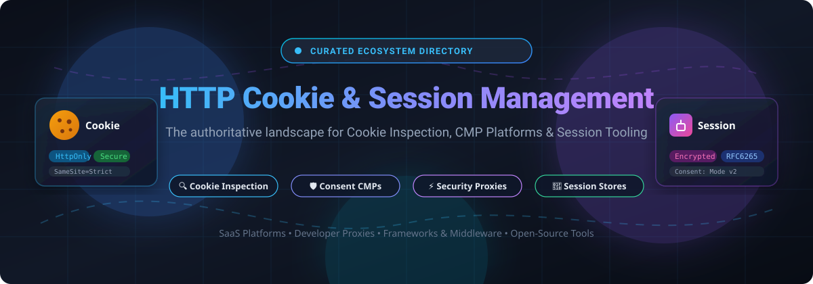

  

# 🍪 Awesome HTTP Cookie &amp; Session Management

  
  
  
  
  
  

> 🚀 A curated directory of top SaaS platforms, security proxies, browser extensions, developer libraries, and open-source tools for **HTTP Cookie &amp; Session Management**, cookie inspection, consent compliance (GDPR/ePrivacy/CCPA), and session security.

---

## 📑 Table of Contents
- [📊 Sector Overview &amp; Market Dynamics](#-sector-overview--market-dynamics)
- [💼 SaaS &amp; Commercial Platforms](#-saas--commercial-platforms)
- [🛠️ Open-Source GitHub Projects](#️-open-source-github-projects)
- [⭐ Star History](#-star-history)
- [💖 Support &amp; Community](#-support--community)
- [🤝 How to Contribute](#-how-to-contribute)
- [⚠️ Disclaimer](#️-disclaimer)

---

## 📊 Sector Overview &amp; Market Dynamics

The global Consent Management Platform (CMP) and web privacy/session management sector is estimated at **$1.1 billion to $1.4 billion** in 2025–2026, projected to expand rapidly toward **$2.5 billion–$6.7 billion** by the 2030s (at a CAGR of ~14–19%) driven by stringent global privacy regulations (GDPR, CCPA/CPRA, ePrivacy, and Google Consent Mode v2).

The commercial enterprise market is **moderately concentrated at the top**—where a handful of enterprise leaders (OneTrust, BigID, and TrustArc) control more than 50% of enterprise market spend—while the developer tooling, proxy, and SMB consent landscape remains **highly fragmented**, fostering a robust ecosystem of specialized privacy suites, local-first proxies, and developer-friendly open-source frameworks.

---

## 💼 SaaS &amp; Commercial Platforms

*Commercial SaaS platforms, enterprise consent management tools, and developer debugging proxies sorted by company valuation / market capitalization (descending).*

| Product | Description | Starting Tier Price | Free Tier / Trial Limits | Company Scale (Valuation / Revenue / Market Cap) |
|---|---|---|---|---|
| **[Postman Cookie Management](https://www.postman.com/)** | 🌐 Cookie jar within Postman for managing session cookies across API requests with domain-level persistence. | **$9/user/month** (Basic/Solo billed annually; $14/mo monthly) | **Free Forever Plan**: 1 user only, unlimited collection runs, up to 30 API calls/mo to Postman API, no team workspaces | **$5.6B Valuation** ($313M+ ARR, backed by Insight Partners) |
| **[OneTrust Cookie Compliance](https://www.onetrust.com/)** | 🛡️ Enterprise privacy and cookie consent management platform supporting automated scans, granular banner controls, and global compliance frameworks. | **~$10,000/year** (Starting contract minimum for core modules) | **14-day Free Trial** via sales contact (Full enterprise module access; no permanent free plan) | **$4.5B–$5.0B Valuation** (~$500M+ ARR, PE-backed) |
| **[Fiddler Everywhere](https://www.telerik.com/fiddler/fiddler-everywhere)** | 🔍 Cross-platform web debugging proxy (macOS, Windows, Linux) to inspect, edit, and mock HTTP/HTTPS session cookies and headers in transit. | **$13/user/month** (Pro plan billed annually; $19/mo monthly) | **10-day Free Trial** (Unrestricted access to all Pro features and team sharing; legacy Fiddler Classic free for Windows non-commercial) | **$1.8B Market Cap** (Parent: Progress Software [NASDAQ: PRGS], ~$978M ARR) |
| **[Cookiebot CMP](https://www.cookiebot.com/)** | 🤖 Automated cookie consent management platform featuring deep website scanning, auto-blocking, and IAB TCF / Google Consent Mode v2 support. | **~$8/month (€7/mo)** (Premium Lite, billed monthly or annually) | **Free Forever Plan**: 1 domain and strictly &lt;50 subpages (manual blocking, 1 language, 30-day consent logs) / **14-day Free Trial** with full Premium features | **€100M+ (~$117M+) ARR** (Parent: Usercentrics / Cybot, growth equity backed) |
| **[Charles Proxy](https://www.charlesproxy.com/)** | ⚡ Desktop HTTP/HTTPS debugging proxy application for intercepting, viewing, and modifying cookies, cache, and session tokens. | **$50 one-time license** (Perpetual single-user license for Charles v5) | **30-day Free Trial** (Full features with 30-minute session limits per launch and 10-second startup delays) | **Privately held boot-strapped micro-SaaS / tool** (XK72 Ltd, est. revenue &lt;$5M) |

---

## 🛠️ Open-Source GitHub Projects

*Curated open-source projects, developer libraries, browser extensions, and self-hosted platforms for HTTP cookies and session management. Ranked by GitHub_Stars (descending).*

| Project | GitHub_Stars | Description | Category |
|---|---|---|---|
| **[js-cookie](https://github.com/js-cookie/js-cookie)** |  | 🍪 Lightweight, dependency-free JavaScript API for reading, writing, and deleting client-side browser cookies across all browsers. | Client Library |
| **[express-session](https://github.com/expressjs/session)** |  | ⚡ The de-facto session middleware for Express.js, storing session IDs in HTTP cookies with pluggable server-side stores (Redis, Mongo, Memcached). | Backend Middleware |
| **[CookieConsent (Orest Bida)](https://github.com/orestbida/cookieconsent)** |  | 🎨 Modern, lightweight (&lt;5kB gzip) cookie consent banner written in pure vanilla JS. Supports Google Consent Mode v2, multilinguality, and dark mode. | Consent Management |
| **[iron-session](https://github.com/vvo/iron-session)** |  | 🔐 Secure, stateless, cookie-based session library for Next.js, Node.js, and web standards. Encrypts session data inside cookies without requiring database lookups. | Backend / Next.js |
| **[Osano Cookie Consent](https://github.com/osano/cookieconsent)** |  | 📜 Popular open-source JavaScript plugin for alerting users about the use of cookies to ensure compliance with EU GDPR and California privacy laws. | Consent Management |
| **[gorilla/sessions](https://github.com/gorilla/sessions)** |  | 🔒 Go session management library providing cookie-based and filesystem session stores with authentication and encryption capabilities. | Backend Middleware |
| **[gin-contrib/sessions](https://github.com/gin-contrib/sessions)** |  | 🚀 Session middleware for the Gin web framework with support for cookies, Redis, Memcached, MongoDB, and GORM stores. | Backend Middleware |
| **[tough-cookie](https://github.com/salesforce/tough-cookie)** |  | 📦 RFC6265 compliant cookie parsing, serialization, and Cookie Jar implementation for Node.js maintained by Salesforce. | Node.js Utility |
| **[gorilla/securecookie](https://github.com/gorilla/securecookie)** |  | 🛡️ Encodes and decodes authenticated and optionally encrypted cookie values for Go HTTP web applications. | Go Utility |
| **[OWASP PTK (Penetration Testing Kit)](https://github.com/DenisPodgurskii/pentestkit)** |  | 🕵️ Interactive browser extension for web application security. Inspects cookies, headers, JWT tokens, and live session traffic with request replay. | Security Browser Extension |
| **[ConsentOS](https://github.com/consentos/consentos)** |  | 🛡️ Self-hosted OneTrust alternative for privacy-first consent management. Supports IAB TCF v2.3, Google Consent Mode v2, and automated cookie scanning. | Self-Hosted CMP |
| **[Conzent OCI](https://github.com/conzent-net/oci)** |  | 🌐 Open Consent Infrastructure: PHP-based multi-tenant open-source consent management platform with headless Chromium cookie crawler. | Self-Hosted CMP |
| **[PhoenixBox](https://github.com/avihayf/PhoenixBox)** |  | 📦 Firefox container extension for penetration testing and bug hunting with complete session and cookie isolation per tab. | Security Extension |
| **[AuthForge](https://github.com/mthcht/AuthForge)** |  | 🔑 Browser addon for extracting, inspecting, and forging `Set-Cookie` headers and authorization tokens during web testing. | Security Extension |
| **[Bokal](https://github.com/yuvibabbar-dev/bokal)** |  | 🍪 Open-source successor to EditThisCookie built on Manifest V3. Full control over `HttpOnly` cookies, SameSite audit hints, and Playwright/Puppeteer storage export. | Browser Extension / Editor |
| **[Hugin](https://github.com/HuginCyber/Hugin)** |  | 🔬 Local-first intercepting security testing proxy in Rust featuring automated cookie jar management and session macro flows. | Security Proxy |

---

## 📈 Star History

---

## 💖 Support &amp; Community

Thank you so much for visiting and using this curated directory! If you found this repository helpful, please consider:
- ⭐ **Starring** the repository to support discovery and visibility
- 🍴 **Forking** and contributing new tools, frameworks, and updates
- 📢 **Sharing** with your fellow developers, QA testers, and security researchers

If you'd like to support ongoing maintenance and the creation of more open developer resources, you can buy a coffee or sponsor the project:

---

## 🤝 How to Contribute

Contributions are warmly welcome!
1. Fork the repository.
2. Add your project or SaaS tool to the appropriate table maintaining table formatting.
3. Keep descriptions objective, specify transparent pricing / star links, and submit a PR with a brief note.

---

## ⚠️ Disclaimer

- This list is **community-curated** for educational, developer, and security audit purposes.
- Cookie and session inspection tools handle sensitive authentication tokens; only test web assets you have explicit legal permission to audit.
- For consent compliance, verify legal requirements with qualified legal counsel in your respective jurisdictions (GDPR, CCPA/CPRA, ePrivacy).
